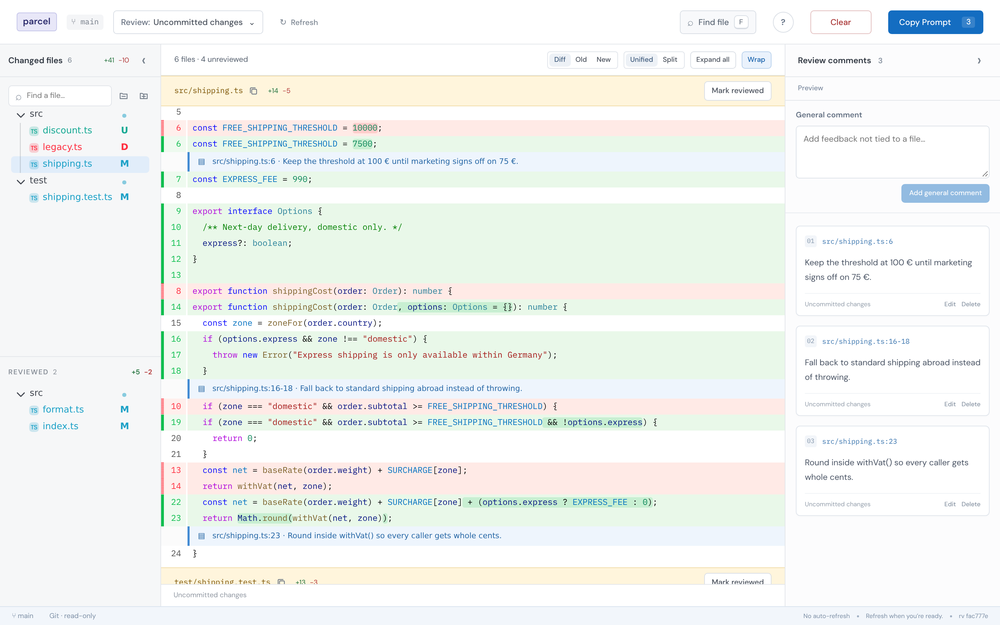
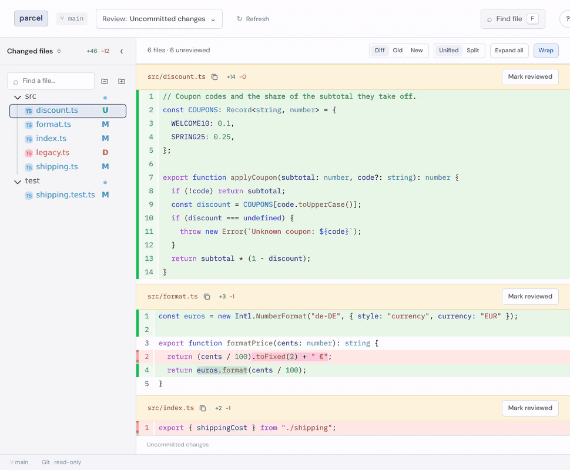
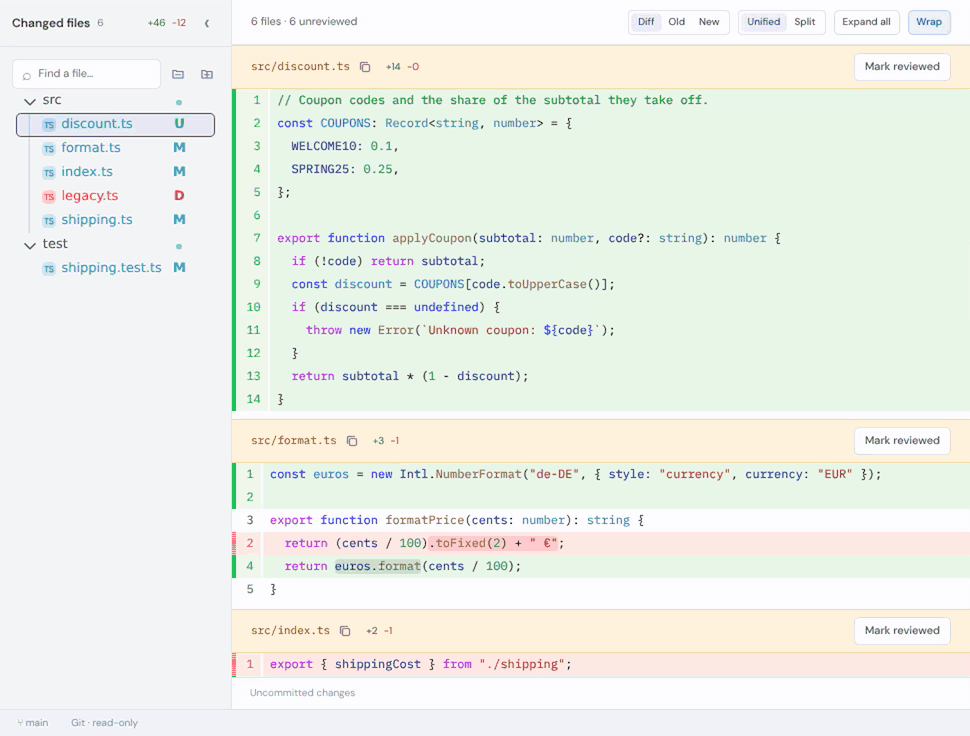
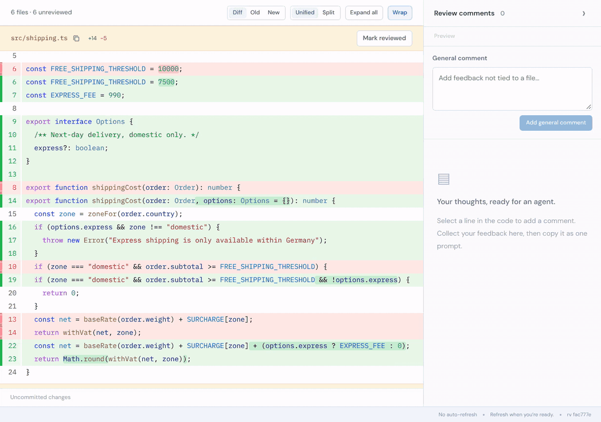
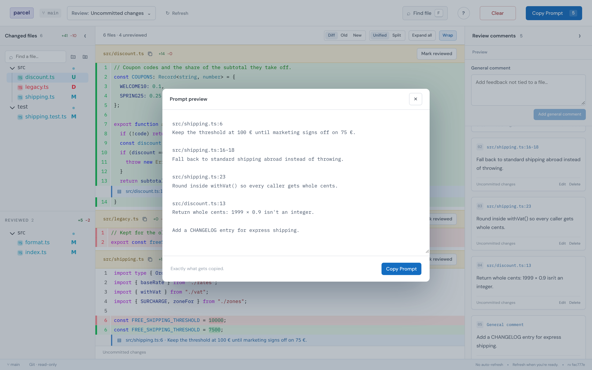
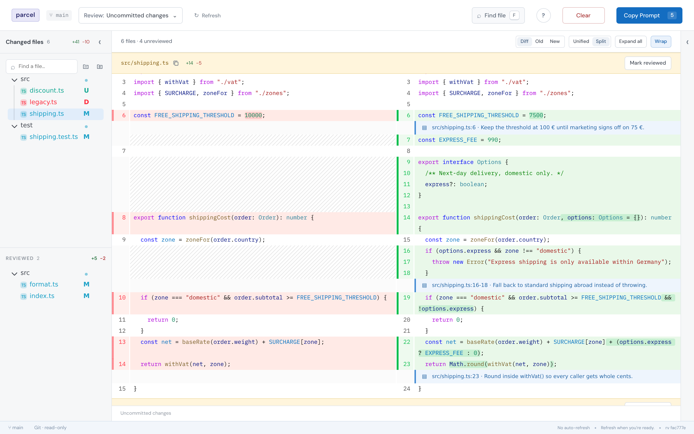
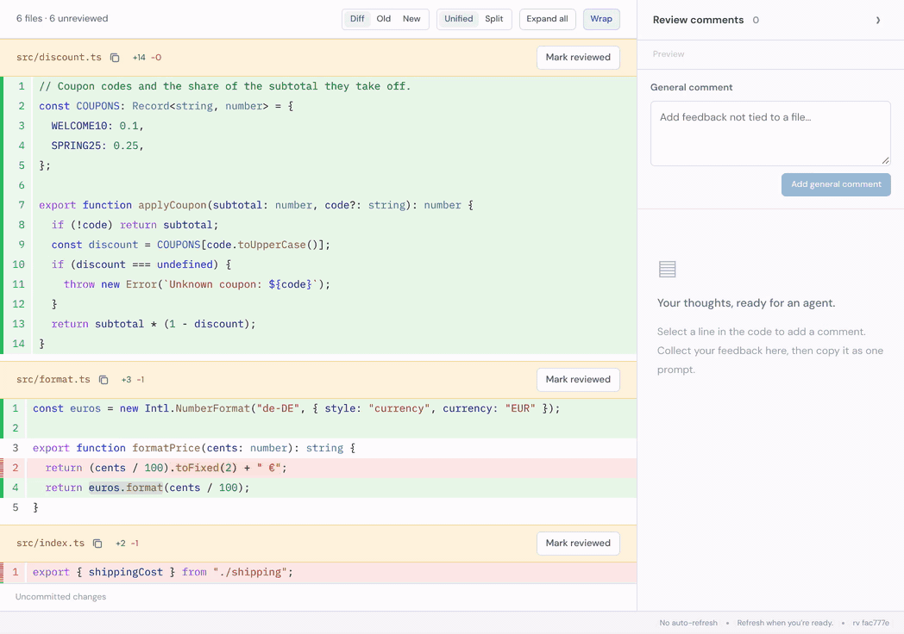
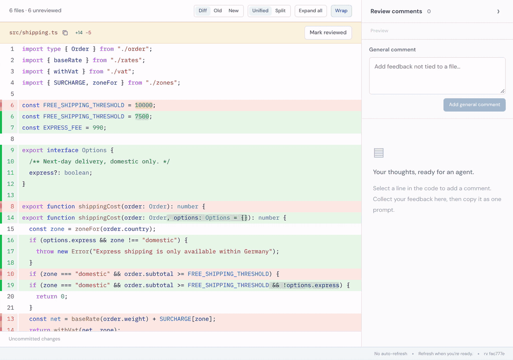

# rv

A small, local code review tool for turning feedback into a prompt for a coding
agent, using [@pierre/diffs](https://diffs.com) and
[@pierre/trees](https://www.npmjs.com/package/@pierre/trees).

There are many tools like this, but this one is customized to my preferences.



## What it does

- Reviews repository files, uncommitted changes, a single commit, or a commit
  range.
- Attaches comments to lines or ranges, plus general comments, and gathers them
  in one place.
- Shows every changed file in one scroll and tracks which ones you have
  reviewed.
- Copies every comment as a concise prompt with exact file and line
  references, or hands it straight to a coding agent.
- Is fast and keyboard-driven: file finder, search across files, and a command
  launcher for everything else.
- Runs entirely on your machine: no account, database, telemetry, or
  source-code upload.

## Features

### Pick what to review

The **Review** menu switches between the File Browser (the repository at
HEAD), uncommitted changes, recent commits, and a range of commits. Type a
branch, tag, or hash to review any other revision. Ranges diff from the merge
base, like a GitHub pull request, and a commit's message shows up as a file you
can comment on.



### Every change in one scroll

**Diff** shows every changed file in one scroll: unreviewed files first, under
slate headers, then reviewed files, under lavender headers. The file tree
follows the file at the top as you scroll; selecting a file scrolls to it.
Mark files reviewed from their header, the file tree (also whole directories),
or with <kbd>R</kbd>; <kbd>U</kbd> undoes it.



### Comment on files, lines and ranges

Click **Comment** in a file header for feedback on the whole file. Hover a line
and click **+** for a line comment, or drag **+** to select a range. Line-number
clicks, Shift-click and <kbd>L</kbd> work too. Line comments work on either side
of a diff and appear inline and in the comments panel. Click a comment's text to
edit it. General comments cover feedback that isn't tied to a file.



### Turn comments into a prompt

**Submit to Agent** sends every saved comment to your coding agent. If handoff
isn't enabled yet, rv offers to connect it in place—no restart needed. The
comments panel shows whether your agent is waiting or feedback is queued.

**Copy Prompt** (<kbd>Y</kbd>) is always available for a manual handoff, with exact
file and line references. **Preview** (<kbd>P</kbd>) shows exactly what gets
sent or copied. After copying, rv offers to clear the review or keep the
comments for later.



### Diff, Old, or New

Choose **Diff**, **Old**, or **New** to see the comparison or the complete file
before or after the change. Comments on Old and New use that revision's line
numbers. Diffs can be unified or split (<kbd>V</kbd>), long lines wrap by
default (<kbd>W</kbd>), and **Expand all** shows the unchanged lines between
hunks.



### Find anything

<kbd>F</kbd> opens a fuzzy file finder, and <kbd>/</kbd> filters the file
tree. <kbd>⌘</kbd>/<kbd>Ctrl</kbd>+<kbd>F</kbd> searches the viewed file, or
every file in the diff, and highlights each match;
<kbd>⌘</kbd>/<kbd>Ctrl</kbd>+<kbd>G</kbd> jumps to the next one. <kbd>J</kbd>
and <kbd>K</kbd> move between files.



### Keyboard first

Press <kbd>?</kbd> or <kbd>⌘</kbd>+<kbd>K</kbd> to search and run any command
and look up its shortcut.



### Links, tabs, and saved state

Cmd-click (Ctrl-click on Windows/Linux) or middle-click a filename to open it
in a new tab. The URL records the selected file and review scope, including
the revisions for a commit or range, the Diff/Old/New choice (`view=diff`,
`view=old`, or `view=new`), split diffs, and expanded unchanged lines. Copy or
bookmark it to return to that view; browser Back/Forward also works. Each tab
navigates independently. Opening the bare URL starts in the File Browser;
unsubmitted range choices are temporary and do not survive reload.

Your review state (comments, reviewed marks, layout preferences) is cached on
local disk, outside the repository, in one readable directory per opened path —
`~/.cache/rv/--home-you-repo--/state.json` on Linux,
`~/Library/Caches/rv/--Users-you-repo--/state.json` on macOS. It survives
server restarts, page reloads and browser changes. Use **Clear** to remove
comments and reviewed marks while keeping your view settings.

Reviewed files are fingerprinted with MD5. On reload or refresh, unchanged
files stay reviewed; changed files return to Unreviewed with a **New changes
since review** pill (and a compact **NEW** badge in the file tree). Reviewing
the file again acknowledges its current contents and clears the warning.

## Run it

Requires Node.js 22+ and Git.

```sh
npm ci
npm run build
npm link
```

Then run `rv` inside any repository:

```sh
rv
```

rv opens a browser and serves a read-only review UI on localhost. Refresh the
page (or press <kbd>Shift</kbd>+<kbd>R</kbd>) when you want to load new
repository changes; nothing is written back to the repository.

Open directly on uncommitted changes, a single commit, or a commit range:

```sh
rv --working              # uncommitted changes
rv --commit HEAD          # a single commit
rv --range main..HEAD     # a commit range
```

`--commit` and `--range` accept anything Git understands (branch, tag, short or
full hash). The three options are mutually exclusive.

Use `rv --help` for directory, port, host, and browser options.

### Background review servers

For agents and scripts, `ensure` starts a detached localhost server, prints
its URL, and exits without opening a browser:

```sh
rv ensure [directory]      # restart and print the review URL
rv ensure --commit HEAD   # review committed changes
rv list                   # PID, URL, and opened directory
rv stop /path/to/repo      # stop this directory's servers
rv stop                   # stop all registered local servers
```

Every `ensure` gracefully restarts the directory's registered servers, including
foreground instances, using the current rv installation. It preserves the port
unless `--port` overrides it, and keeps comments and reviewed marks. The server
survives the calling shell or agent; refresh existing tabs after a restart.
It does not automatically restart after a crash or reboot.

The directory defaults to the current directory and resolves to its Git
working-tree root. Subdirectories and symlinked paths share a server; separate
worktrees and submodules get their own. Concurrent restarts are serialized.
Plain `rv` still opens the exact requested directory in the foreground.
`list` and `stop` manage registered local servers, not remote ones or servers
started by versions of rv without this feature.

Runtime metadata and logs live outside the repository in rv's platform cache
directory (`RV_CACHE_DIR` overrides it). Abandoned locks are recovered
automatically and stale instance records are ignored. Stopping a server does
not clear review state.

After updating or rebuilding rv, `rv ensure /path/to/repo` replaces that
repository's servers with the current installation. There is no version
comparison or background upgrade mechanism; other servers keep their loaded
code until restarted. Use `rv stop` to shut down all registered local servers.

### Agent integration

Start rv in agent mode to send review prompts directly to a coding agent:

```sh
rv --agent
```

Or start a detached agent session and share the printed URL with the user:

```sh
rv ensure --agent
```

Run `ensure` only once per review session, not between review rounds. Each
invocation restarts the server: submitted prompts queued in memory are lost,
and pending `rv --wait` calls are interrupted. Consume queued feedback before
restarting. Include `--agent` on each `ensure` that should enable agent mode;
without it, the new server starts with handoff disabled (you can enable it
from the page).

**Submit to Agent** is always visible. On a regular localhost server, click
**Connect agent** in the comments panel to enable handoff without restarting.
If you already have comments, **Submit to Agent** offers **Enable & submit**.
This connects rv's handoff channel; it does not launch a coding agent.
**Copy instructions** gives you a message to paste into your existing agent.

The flow is simple:

1. **Your agent** starts `rv ensure --agent`, shares the URL, and runs `rv --wait`.
2. **You** review in the browser, save comments, and click **Submit to Agent**.
3. **Your agent** receives the feedback, makes changes, and runs `rv --wait` again.
4. **You** refresh the page and review the next round. No server restart needed.

The handoff card shows **Agent is waiting** when an agent is actively waiting,
or the number of queued reviews when it isn't. Submission clears the saved
comments only after rv accepts the prompt, keeping reviewed marks and leaving
the server open for another round. **Copy Prompt** remains available in either
mode. The agent receives one submitted prompt by running:

```console
$ rv --wait
src/shipping.ts:6
Keep the threshold at 100 € for now.
```

`rv --wait` prints the prompt to stdout and exits. Run it again to wait for the
next submission. Prompts submitted between calls are queued by the running rv
process. Coding agents can run `rv --skill` for a short description of this
workflow. Use `rv stop .` when the session is finished.

## Development

```sh
npm run build
npm test
npm run test:browser
```
